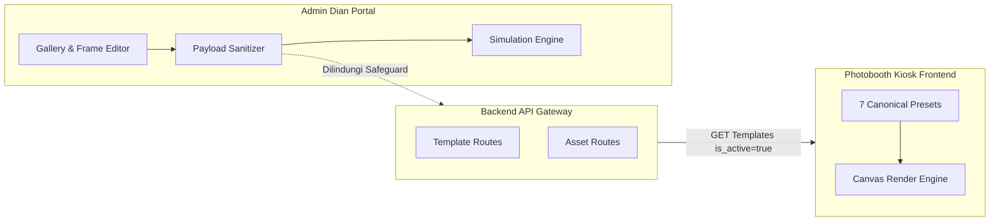

# DOKUMEN PENUTUPAN & SERAH TERIMA MODUL 2
## Gallery Templates, Frame Editor, & Sticker Library Integration

- **Repository:** `diantsdaeli/UNISMILES-ADMIN`
- **Branch:** `feature/unismiles-integration`
- **Baseline Commit:** `0917a16ef2b1e5b97c022efca407c4f63556a904`
- **Tanggal Selesai:** 22 Oktober 2026
- **Status Akhir:** **Simulation & Contract Ready (933 Automated Tests PASS)**

---

### 1. Ringkasan Implementasi Modul 2

Modul 2 mengintegrasikan Gallery Templates, Fullscreen Canvas Frame Editor, dan Sticker Library pada aplikasi Admin Dian dengan backend API resmi (`nathaniapelleng15/backend_uni_gateway`) serta kompatibilitas penuh terhadap frontend Kiosk Photobooth (`nathaniapelleng15/frontend_uni_gateway`).

Seluruh pengembangan diselesaikan melalui tahapan berkesinambungan:
- **Tahap 3B:** Audit kontrak API dan implementasi safeguard backend `ENABLE_BACKEND_MUTATIONS = false`.
- **Tahap 3C:** Integrasi terisolasi Create & Edit Frame dengan mock API terisolasi (236 tests).
- **Tahap 3D:** Integrasi Sticker Library & Asset Management, upload multipart/form-data, dan normalisasi respons backend (310 tests).
- **Tahap 3E:** Kompatibilitas end-to-end Admin Dian → Backend API → Photobooth Kiosk, perbaikan visual stiker scrapbook SVG bawaan, pemrosesan transparansi gambar (532 -> 743 tests).
- **Tahap 3F:** Final acceptance & integration readiness audit (743 tests).
- **Tahap 3G:** Safe staging preparation, penutupan celah integrasi, sanitasi payload (pencegahan URL blob & data URI biner), allowlist staging eksplisit fail-closed, dan fail-closed asset deletion (911 -> 933 tests).

---

### 2. Daftar Fitur yang Telah Selesai (Operational & Verified)

1. **Authentication & Session Security (Modul 1):**
   - Login, logout, dan verifikasi sesi backend (`/auth/me`).
   - Anti flash content Super Admin untuk sesi tidak sah.
   - Sinkronisasi cached user dengan validasi sesi aktif.
2. **Gallery Templates Browsing & Filtering:**
   - Visualisasi template kartu responsif dengan thumbnail preview.
   - Filter 7 layout preset kanonikal (`1x1`, `2x1`, `3x1`, `4x1`, `2x2`, `2x3`, `3x3`).
   - Filter kategori sekunder dan pencarian nama template.
   - Tampilan status publikasi (`active` vs `inactive` / draft).
   - Tampilan harga paket (dasar, digital, cetak).
3. **Sticker Library & Scrapbook Assets:**
   - 25 stiker scrapbook SVG vektor bawaan beresolusi tinggi tanpa dependensi jaringan.
   - Penanganan fallback aset gambar rusak / missing image via SVG inline.
   - Upload stiker khusus format PNG dengan validasi MIME dan ukuran berkas.
   - Fitur penghapusan background instan lokal (flood-fill transparency engine).
4. **Data Normalization & Contract Mapping:**
   - Adapter respons backend (`adaptBackendTemplateToDian`).
   - Normalisasi aset reusable backend (`normalizeAsset`).
   - Serialisasi kanvas format Kiosk (`buildCreateTemplatePayload`, `buildUpdateTemplatePayload`).
5. **Safeguards & Sanitasi Keamanan:**
   - Penolakan mutlak URL blob (`blob:`) pada semua payload template.
   - Penolakan data URI biner base64 (`data:image/png;base64`) pada payload produksi.
   - Pemblokiran penghapusan aset jika digunakan oleh template (aktif maupun draft).
   - Pemblokiran fail-closed penghapusan aset jika data template belum lengkap (`isIncompleteData: true`).

---

### 3. Daftar Fitur dalam Mode Simulasi (Simulation Ready)

Fitur-fitur berikut telah memiliki kontrak antarmuka dan adapter yang lengkap serta teruji secara otomatis, namun sengaja berjalan dalam mode simulasi aman di frontend untuk melindungi backend produksi:

1. **Create Frame (`POST /api/v1/admin/templates/generate`):**
   - Dalam mode default, perubahan disimpan ke state lokal dan simulasi sukses ditampilkan ke pengguna. Tidak ada HTTP request mutasi nyata yang dikirim ke server produksi.
2. **Edit Frame (`PUT /api/v1/admin/templates/:id`):**
   - Dalam mode default, modifikasi template disinkronkan ke TemplateContext dan localStorage.
3. **Upload Asset (`POST /api/v1/admin/assets`):**
   - Disimpan dengan prefix `sim-*` ke localStorage perangkat pengguna.
4. **Delete Asset (`DELETE /api/v1/admin/assets/:id`):**
   - Menguji dependensi secara fail-closed, kemudian membersihkan cache lokal tanpa mengirim DELETE ke server produksi.

---

### 4. Daftar Endpoint Terkait

| Endpoint | Method | Status Integrasi | Keterangan |
|---|---|---|---|
| `/api/v1/auth/me` | GET | Operational | Verifikasi sesi aktif pengguna |
| `/api/v1/admin/templates` | GET | Operational | Mengambil daftar template frame |
| `/api/v1/admin/templates/generate` | POST | Simulation Ready | Membuat template frame baru (dilindungi flag) |
| `/api/v1/admin/templates/:id` | PUT | Simulation Ready | Memperbarui template frame (dilindungi flag) |
| `/api/v1/admin/assets` | GET | Operational | Memuat daftar aset stiker & overlay |
| `/api/v1/admin/assets` | POST | Simulation Ready | Upload aset baru (multipart/form-data) |
| `/api/v1/admin/assets/:id` | DELETE | Simulation Ready | Menghapus aset (dilindungi fail-closed check) |
| `/api/v1/kiosks` | GET | Operational | Mengambil daftar kiosk terdaftar |

---

### 5. Matriks Readiness (Kesiapan Modul 2)

| Komponen | Status Kesiapan | Catatan |
|---|---|---|
| UI Gallery & Frame Editor | **100% Siap** | Tampilan disetujui, interaktif, responsif |
| Kontrak Data Dian ↔ Nadin | **100% Siap** | 7 layout canonical sesuai standar hardware kiosk |
| Visual Scrapbook Assets | **100% Siap** | 25 aset SVG lokal tajam tanpa kotak hitam |
| Automated Test Coverage | **100% Siap** | 933 tests lulus tanpa kegagalan |
| Backend Production Protection | **100% Terkunci** | `ENABLE_BACKEND_MUTATIONS=false`, allowlist kosong |
| Pengujian Backend Staging Riil | **Tertunda** | Menunggu penyediaan server staging terisolasi |
| Pengujian Kiosk Fisik | **Tertunda** | Memerlukan perangkat hardware kiosk fisik di lab |

---

### 6. Risiko dan Keterbatasan

1. **Ketiadaan Server Staging Terisolasi:**
   - Backend resmi saat ini tidak memiliki lingkungan staging terpisah dengan basis data terisolasi. Mengarahkan URL ke backend yang sama berisiko memanipulasi data riil.
2. **Keterbatasan Validasi Dependensi di Frontend:**
   - Pemeriksaan dependensi aset di frontend bersifat optimistik fail-closed. Database backend tetap wajib memiliki foreign key constraint atau pengecekan relasi sebelum penghapusan riil diaktifkan.
3. **Penyimpanan Aset Gambar Ukuran Besar:**
   - Template dengan background gambar resolusi tinggi harus menggunakan URL aset yang terunggah, bukan data URI biner base64 besar, untuk menghindari limit ukuran request HTTP backend (413 Payload Too Large).

---

### 7. Safeguard yang Wajib Dipertahankan

Pengembang atau tim deployment **DILARANG** mengubah baris konfigurasi berikut sebelum syarat aktivasi staging terpenuhi:
1. `src/lib/templates.ts`:
   ```ts
   export const ENABLE_BACKEND_MUTATIONS = false;
   export const VERIFIED_STAGING_ALLOWLIST: readonly string[] = [];
   ```
2. `src/lib/assets.ts`:
   - Penolakan fail-closed pada penghapusan aset jika `isIncompleteData === true`.

---

### 8. Status Integrasi End-to-End: Admin → Backend → Kiosk



- **Kiosk Compatibility:**
  - Presets: `1x1`, `2x1`, `3x1`, `4x1`, `2x2`, `2x3`, `3x3`.
  - Label UI: `3x1` = "Strip 3", `4x1` = "Strip 4" (cocok dengan photobooth flow).
  - Slot geometry dan kalkulasi bounding box terbukti berada di dalam kanvas kanonikal pada automated tests.

---

### 9. Panduan Pengujian Ulang (Regression Suite)

Untuk memvalidasi integritas kode secara berkala, jalankan perintah berikut:
```bash
# 1. Linting tipe TypeScript
npm run lint

# 2. Bundle build Vite
npm run build

# 3. Seluruh 7 suite automated tests (933 tests)
npm test

# 4. Pengujian khusus Modul 2 Safe Staging & Asset Deletion
npm run test:stage3g
```

---

### 10. Persyaratan Aktivasi Staging & Produksi

Sebelum mengaktifkan `ENABLE_BACKEND_MUTATIONS = true`:
1. Server staging terpisah telah disiapkan dengan database MariaDB/MySQL mandiri (bukan replikasi produksi).
2. Host staging resmi telah didaftarkan pada `VERIFIED_STAGING_ALLOWLIST`.
3. Telah dilakukan uji mutasi `POST /admin/templates/generate` pada staging dan hasilnya diverifikasi pada database staging.
4. Uji tampilan frame baru pada Kiosk yang terhubung ke server staging.

---

### 11. Baseline Commit Modul 2

- **Commit Baseline:** `0917a16ef2b1e5b97c022efca407c4f63556a904`
- **Branch:** `feature/unismiles-integration`
- **Pesan Commit:** `fix(gallery): enforce fail-closed staging and asset deletion safeguards`

---

### 12. Rekomendasi Awal untuk Modul 3 (Printer Configuration)

1. **Adopsi Komponen Konfigurasi Printer:**
   - Mengadopsi arsitektur dari `admin_uni_gateway/src/components/PrinterConfiguration.tsx` dan `src/lib/printPapers.ts`.
2. **Dukungan Dua Jenis Hardware Printer:**
   - Printer foto dye-sublimation / Windows spooler (format kertas 4R, 2R, strip).
   - Printer label termal Bluetooth (NIIMBOT B1 Pro / B21) dengan batas lebar cetak fisik 48 mm dan algoritma dithering 1-bit.
3. **Penerapan Safeguard yang Sama:**
   - Mempertahankan mode simulasi untuk perintah uji cetak (`test-print`) sebelum hardware fisik terhubung.
